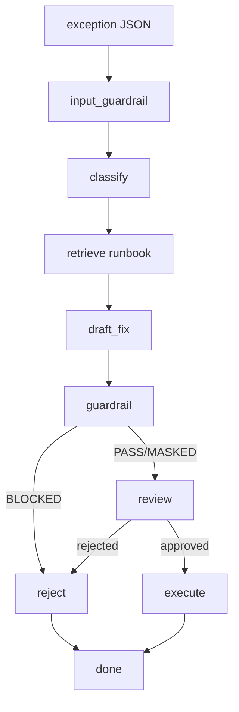

# Settlement Exception Triage Agent

A personal project that uses [LangGraph](https://github.com/langchain-ai/langgraph) with AWS Bedrock (or local LM Studio) to classify, retrieve runbook context, draft fixes, and route trade settlement exceptions through a guardrailed human-in-the-loop workflow.

**Status:** Personal experiment. Uses synthetic data. Not production.

## Architecture



Graph nodes:

| Node | What it does |
|---|---|
| input_guardrail | Check input for PII/sensitive data before processing |
| classify | LLM classifies the exception into one of 7 categories |
| retrieve | FAISS vector search over runbook markdown files |
| draft_fix | LLM drafts fix steps citing retrieved runbook chunks |
| guardrail | Bedrock ApplyGuardrail (or regex stub) on the draft |
| review | Human-in-the-loop approval/rejection (SQLite checkpointed) |
| execute | Apply fix with idempotency key (simulated settlement system) |
| reject | Mark exception as rejected |

## Setup

Create a `.env` file. For Bedrock:

```env
LLM_PROVIDER=bedrock
BEDROCK_MODEL_ID=us.anthropic.claude-sonnet-4-6
AWS_REGION=us-west-2
GUARDRAIL_ID=<your guardrail ID>
GUARDRAIL_VERSION=2
GUARDRAIL_REGION=us-east-2
AWS_PROFILE=bedrock-triage
```

For local LM Studio (no AWS):

```env
LLM_PROVIDER=local
LMSTUDIO_MODEL=your-local-model
LMSTUDIO_BASE_URL=http://localhost:1234/v1
```

Build the FAISS index from the runbook before running:

```bash
python scripts/build_index.py
```

## Run

Submit an exception (stops at review):

```bash
python scripts/triage_cli.py submit samples/exception_001.json
```

Review and decide (CLI):

```bash
python scripts/triage_cli.py review run-T-1042
```

Or use the web review page (no auth, intended for Tailscale):

```bash
python scripts/review_server.py
# http://0.0.0.0:8080
```

## Design decisions

- **LangGraph:** Needed checkpointed graph execution with conditional routing and human-in-the-loop interruption. The review node pauses the graph to SQLite, waits, then resumes on user input.
- **ApplyGuardrail as a node:** Guardrails are applied in their own node rather than baked into the LLM call. This lets the guardrail independently inspect the draft before it reaches the human, and gives a clean BLOCKED → reject routing path.
- **Idempotency:** The execute node computes a SHA-256 key from (trade_id, category, fix steps) and stores it in the simulated settlement system with a UNIQUE constraint. Duplicate submissions are skipped rather than re-executed.
- **SQLite checkpointing:** Checkpointed to `data/checkpoints.db` so the graph survives restarts and review can happen later.

## Eval results (latest)

Model: `amazon.nova-micro-v1:0` (Bedrock), 18 synthetic cases

| Metric | Result |
|---|---|
| Category accuracy | 15/18 (83.3%) |
| Guardrail decision accuracy | 15/18 (83.3%) |
| Avg latency (s) | ~3.2 |

Cases 05, 18 misclassified (INSUFFICIENT_CASH → PRICE_TOLERANCE_BREAK). Cases 16-18 expected guardrail intervention that didn't fire.

## What production would need

- Real settlement system integration instead of simulated SQLite
- Secret management (AWS Secrets Manager, not .env files)
- Production-grade monitoring and alerting (not just audit.log)
- Guardrails tuned and validated on real data (the synthetic test set underestimates PII leakage)
- Auth on the review endpoint
- Load testing and concurrency handling
- Schema validation on inputs (currently trusts JSON structure)
- Fallback paths for model timeouts/errors
- Rate limiting and cost tracking
- Real error handling and retries (currently most errors bubble to the CLI)
- Access controls and RBAC for the review process
- Observability tracing (OpenTelemetry, not just audit entries)
